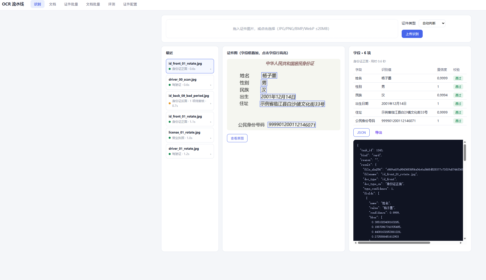
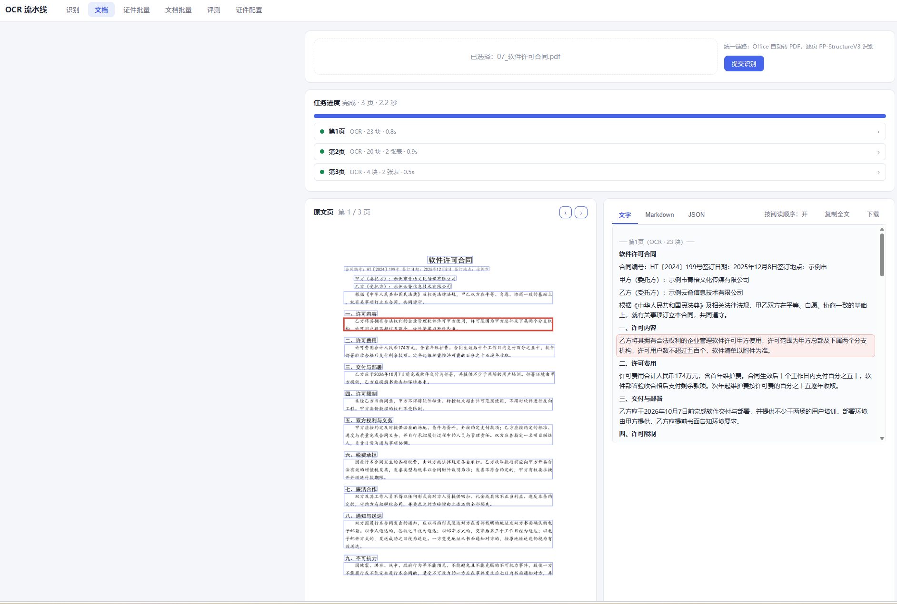
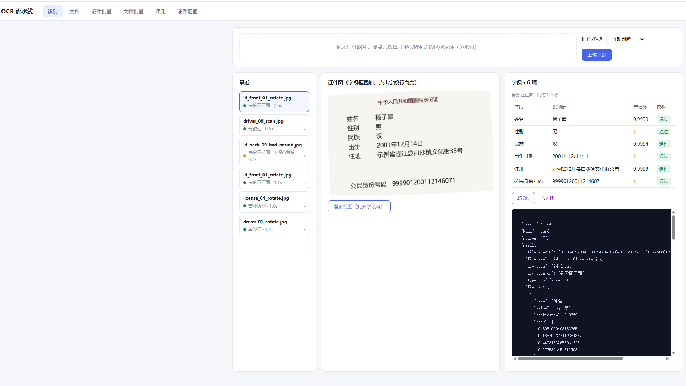
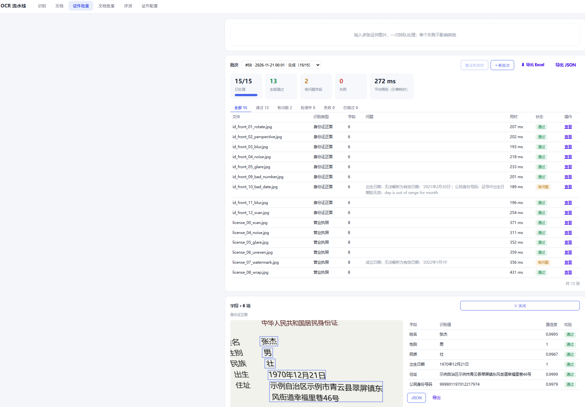
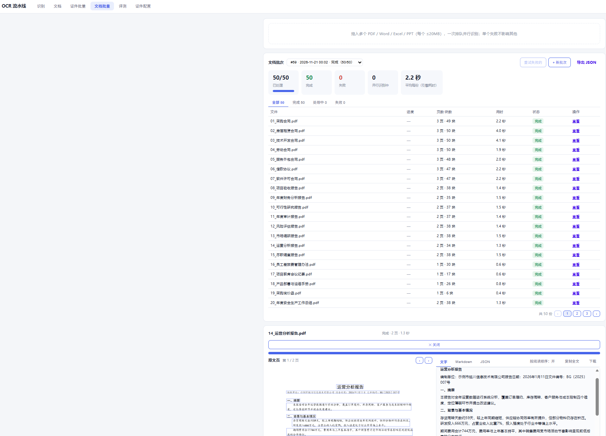
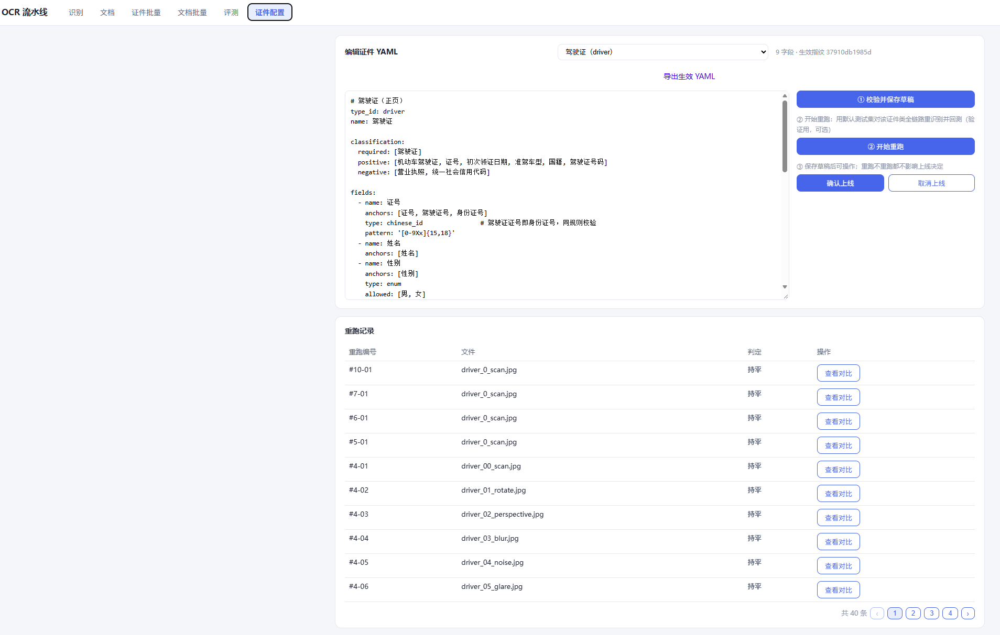
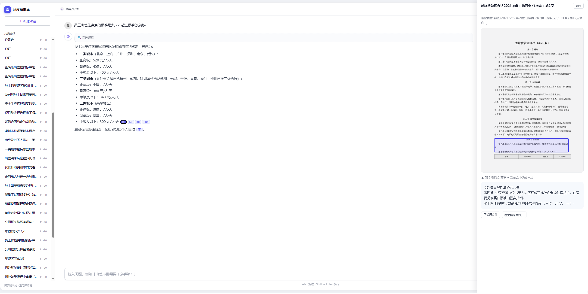
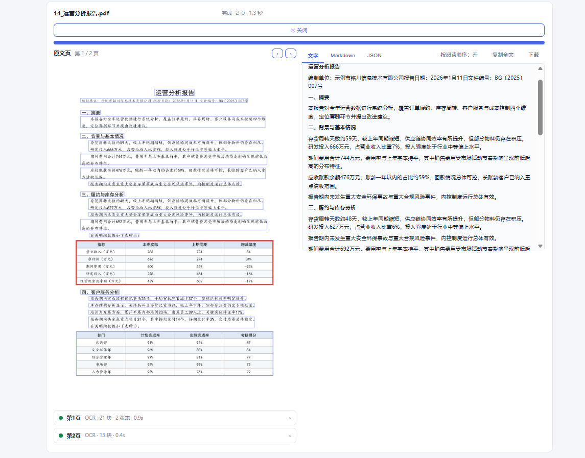

# Super OCR

Super OCR 包含两个可联动的文档处理服务。**OCR 流水线**负责识别证件和解析文档版面，输出可校验的结构化结果。**制度知识库**调用 OCR 服务解析上传的文件，并基于原文提供带出处的检索与问答。

##注意以下测试集均为虚构，仅用于本项目测试使用，如有雷同请联系作者删除

## OCR 流水线

- **证件识别**支持身份证、驾驶证和营业执照等类型，输出结构化字段、置信度及校验结果。工作台可以同时查看字段卡和完整 JSON。
- **文档识别**支持 PDF 及 Word、Excel、PowerPoint 等 Office 文件。Office 文件先经 LibreOffice 转为 PDF，再由 PP-StructureV3 逐页识别标题、表格和阅读顺序。
- **批量评测**支持逐文件查看耗时、识别结果和通过状态，失败文件可单独重试。评测界面可在原图上定位错误字段，识别规则可通过 YAML 配置和回测。

**证件识别与 JSON 对照**

**批量评测与错误定位**

查看字段卡、批量明细、逐文件对照和 YAML 配置

**结构化字段卡**

**批量评测明细**

**逐文件对照**

**流水线配置**

## 制度知识库

- **自动摄入**将上传的制度文档提交给 OCR 流水线，按章节和内容块入库，并保留对应的原文页码和位置。
- **混合检索**结合 FAISS 向量检索与 SQLite FTS5 关键词检索，查找相关条款、正文段落和表格。
- **带出处的问答**流式生成回答，点击引用即可查看对应的原文页面。资料不足时，系统会提示未找到相关规定。

**智能问答与原文预览**

**文档解析与表格定位**

## 两个服务如何联动

在知识库上传文件后，知识库通过 HTTP API 提交 OCR 任务并轮询结果。OCR 返回逐页结构化数据后，知识库切块并建立索引。用户提问时，系统检索相关内容，并在回答中附上可以回跳原文的引用。

## 运行与文档

先启动 OCR API 和 worker，再启动制度知识库。使用演示中的端口时，OCR API 在 `8700`，知识库页面在 `8800`。解析 Office 文件需要 LibreOffice，知识库的向量检索和问答生成需要在本地配置 DashScope API 密钥。

| 文档 | 内容 |
| --- | --- |
| [OCR 服务说明](01-OCR流水线/服务/README.md) | 识别接口、批量任务和评测方法 |
| [制度知识库服务说明](02-制度知识库/服务/README.md) | 本地启动、环境变量与 API |
| [部署文档](deploy/部署文档.md) | GPU 环境、启动脚本与验证步骤 |
| [知识库自测报告](02-制度知识库/自测报告.md) | 评测结果与逐题归因 |
| [项目展示页](项目展示/项目说明.html) | 完整演示说明与截图，可在本地浏览器打开 |
